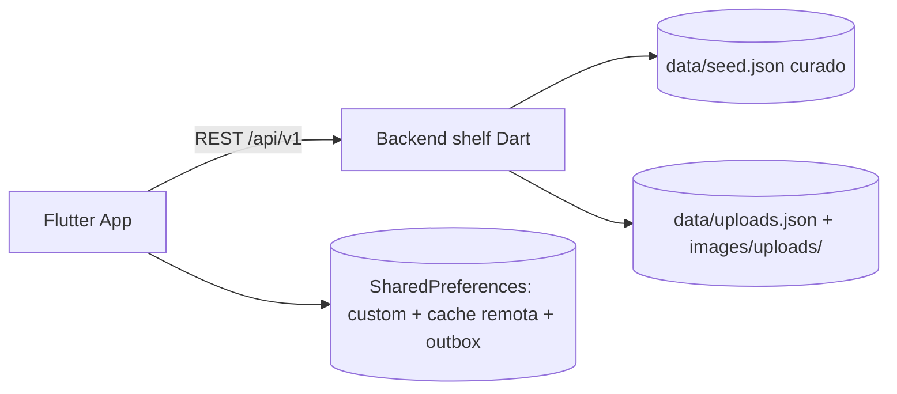

# Arquitectura PictoComm

Este documento ES la restriccion y definicion de arquitectura.
Todo diseno e implementacion DEBE conformarse a lo aqui definido.

Convenciones: **DEBE** = obligatorio, **NO DEBE** = prohibido,
**PUEDE** = permitido. Las verificaciones estan en cada seccion.

> **Historial:** el plan original (FastAPI/Python + Postgres + S3 + Docker,
> "online-first", sin escritura offline) fue **reemplazado por decisiones
> confirmadas del usuario** registradas en los REQ:
> stack Dart (shelf) y seed JSON (REQ-BCK-01, decisiones 1-3) y subida
> bidireccional con outbox (REQ-BCK-02, decision 4-8). Este documento
> describe la arquitectura vigente al 2026-11-17 (v2 aprobada).

---

## 1. Restricciones innegociables

1. Frontend **DEBE** implementarse en **Flutter** (un solo codigo multiplataforma).
2. Backend **DEBE** implementarse en **Dart con shelf** (paquete puro sin Flutter
   en `src/backend/`), un solo lenguaje en todo el repo (REQ-BCK-01, decision 1).
3. La app es **local-first**: **DEBE** funcionar sin conexion; las **lecturas
   NUNCA DEBEN** tocar la red (RF-5.11). El unico trafico saliente es el sync
   de descarga (al arrancar) y el flush del outbox de subida (REQ-BCK-02).
4. El frontend **NO DEBE** acceder a bases de datos ni storage remotos.
   Solo consume la API por `REST + JSON` a traves de `RemoteCatalogDataSource`.
5. Toda configuracion de entorno **DEBE** ser inyectable sin editar codigo:
   URL del backend por `--dart-define=PICTOCOMM_BACKEND_URL` (default
   `http://localhost:8080`) y puerto del server por variable `PORT`.

Verificacion: un revisor puede rechazar cualquier PR que viole 1-5 sin mas argumento.

---

## 2. Estilo arquitectonico

- Sistema **cliente-servidor desacoplado**: app Flutter <-> API REST JSON.
- Backend: **monolito modular** (un paquete Dart, un proceso).
  **NO DEBE** dividirse en microservicios.
- Frontend: **Clean Architecture ligera por feature** (sec. 4).
- Comunicacion sincrona `HTTP/JSON`. **NO DEBE** introducirse gRPC, GraphQL ni
  websockets.



---

## 3. Estructura del repositorio

```text
docs/architecture/architecture.md   # este archivo (normativo)
docs/specs/                         # specs de usuario (aprobadas/)
docs/requerimientos/implementados/  # normativa REQ-* por feature
src/frontend/                       # app Flutter (sec. 4)
src/backend/                        # API Dart/shelf (sec. 5)
overview.md                         # objetivo del producto (no normativo)
```

Regla: `src/frontend` y `src/backend` **NO DEBEN** importarse entre si.
El acople permitido es el **formato JSON compartido** de los models Dart
(`PictoModel`/`CategoryModel`): cambiar un campo del formato exige actualizar
seed/backend en el mismo cambio (RNF-3.9 de REQ-CAT-02).

---

## 4. Frontend Flutter: modelo obligatorio

### 4.1 Arbol de archivos

```text
lib/
  main.dart
  app.dart
  core/
    constants/app_routes.dart
    di/injector.dart           # composition root (AppDependencies)
    error/app_exception.dart
    theme/app_theme.dart
    utils/data_url.dart
  features/
    catalog/
      domain/          # entidades + interfaces de repositorio (puro)
      data/            # models JSON + datasources (local/custom/remote/cache/outbox) + repos
      presentation/    # providers + screens + widgets
    profiles/          # misma estructura
    sync/              # servicio + UI de estado de sync (REQ-BCK-02)
    voice/ auth/ ...
```

### 4.2 Reglas de dependencia

```text
presentation -> domain <- data
core NO importa features. domain NO importa Flutter (salvo dart:ui Color).
```

- `presentation/` **DEBE** depender solo de interfaces de `domain/`.
  **NO DEBE** importar `data/`.
- `data/` **DEBE** implementar las interfaces de `domain/` y traducir
  errores HTTP a `AppException`. **NO DEBE** filtrar logica de negocio a widgets.
- `domain/` **NO DEBE** conocer assets, SharedPreferences ni HTTP.

### 4.3 Vocabulario de dominio (obligatorio)

| Concepto | Tipo | Notas |
|---|---|---|
| `Picto` | entidad | Imagen que toca el nino. `categoryIds: List<String>` desde REQ-CAT-02 (1..n categorias). **NO DEBE** usarse `Symbol` (colisiona con `dart:core`). |
| `PictoSource` | enum | `bundled` / `custom` / `remote`. El switch de render vive en un solo widget (`PictoCard`). |
| `Category` | entidad | Grupo de pictos. Importar Flutter con `hide Category` si colisiona. |
| `ChildProfile` | entidad | Nino usuario. Varios por dispositivo. |

### 4.4 Datos y estado

- Cada feature **DEBE** exponer: `*Repository` (interfaz en `domain/`)
  implementada por datasources en `data/`.
- `RemoteCatalogDataSource` **DEBE** ser el unico punto que hace HTTP.
  La UI **NO DEBE** usar `http`/`dio` directamente.
- Storage local: **SharedPreferences** con claves prefijo `pictocomm.*`
  separadas por dominio (`custom_*` creaciones del adulto, `remote_*` cache
  del backend, `outbox_*` cola de subida).
- Lecturas **DEBEN** salir SIEMPRE de local: bundled (assets) + custom +
  remoto cacheado, con dedup por id (gana la copia local del dueno).
- Sync de descarga: al arrancar, fire-and-forget, incremental por
  `updatedAt` (`since`); falla en silencio (RF-5.10).
- Subida (REQ-BCK-02): cada cambio custom **DEBE** encolarse en el outbox y
  subirse fire-and-forget; reintentos al arrancar, tras cada operacion y con
  el boton manual. Los conflictos se resuelven last-write-wins por
  `updatedAt`; el server siempre responde con la version ganadora y la app
  la adopta **conservando su imagen local** (offline del dueno intacto).
- El estado de sync es observable (`SyncService`) y solo se muestra en modo
  adulto (Perfil).

### 4.5 Calidad frontend (puertas de merge)

- `flutter analyze`: **0 issues**.
- `flutter test`: **todo verde**. Los tests **DEBEN** inyectar dependencias
  falsas (`test/helpers/fakes.dart`); **NO DEBEN** tocar `AssetManifest` ni
  red real. `ExplodingRemoteDataSource` garantiza local-first: si una lectura
  toca el remoto, el test rompe.
- Reglas Dart vigentes: `Color.value` prohibido (usar `toARGB32()`),
  `CupertinoPageTransitionsBuilder` se importa de `package:flutter/cupertino.dart`,
  `rootBundle` de `package:flutter/services.dart`.

---

## 5. Backend Dart/shelf: modelo obligatorio

### 5.1 Arbol de archivos

```text
src/backend/
  bin/server.dart              # shelf_io.serve; PORT por env; CORS abierto
  lib/src/
    catalog_store.dart         # seed (solo lectura) + uploads (mutables, persistidos)
    api_handler.dart           # router: lectura v1 + escritura REQ-BCK-02
  data/
    seed.json                  # catalogo curado (versionado en el repo)
    images/                    # imagenes del seed
    images/uploads/            # imagenes subidas por dispositivos (runtime, gitignored)
    uploads.json               # lo subido (runtime, gitignored, mismo formato que seed)
  test/
```

### 5.2 Reglas de codigo

- El server **DEBE** cargar seed + uploads en memoria al arrancar; un seed
  invalido **NO DEBE** crashear: arranca con catalogo vacio y loguea.
- El seed **NO DEBE** modificarse por la API: `PUT`/`DELETE` sobre ids del
  seed responden 403. Solo `data/uploads.json` recibe escrituras.
- El borrado **SIEMPRE** es logico (`deletedAt`): el listado excluye tumbas;
  el sync incremental las entrega para que cada dispositivo purgue su cache.
- Conflictos: **last-write-wins por `updatedAt`** (ISO-8601 UTC, lo porta el
  cliente). La respuesta de `POST`/`PUT` **DEBE** traer la version ganadora.
- Los items subidos se sirven como `source: "remote"` con `imageUrl`
  absoluta y el id `custom-*` del cliente intacto.
- La API **NO DEBE** guardar sesiones en memoria (stateless en peticiones;
  la persistencia es el par de archivos JSON, RNF-5.8).

### 5.3 Calidad backend (puertas de merge)

- `dart analyze`: **0 issues**. `dart test`: **todo verde**
  (`test/api_test.dart` lectura v1, `test/upload_test.dart` escritura v2).
- Tests minimos exigidos: `GET /health`, `GET /api/v1/categories`,
  `GET /api/v1/pictos` (con filtros), `404` de inexistente, `400` de filtros
  invalidos, CRUD de subida con conflictos y tumbas, persistencia de uploads
  tras reinicio y seed intocable.
- Logs a `stdout`, sin archivos locales.
- `data/uploads.json` e `images/uploads/` **NO DEBEN** versionarse
  (gitignored): son datos de runtime de los dispositivos.

---

## 6. Modelo de datos (contrato compartido)

Tipos con `camelCase` en JSON. `createdAt/updatedAt` en UTC ISO-8601 y
**DEBEN** existir siempre (base del sync incremental).

```json
{
  "id": "custom-1699999999-0",
  "label": "Agua",
  "categoryIds": ["bebidas", "rutina"],
  "imageUrl": "http://localhost:8080/images/uploads/custom-1699999999-0.png",
  "source": "remote",
  "createdAt": "2026-01-01T00:00:00Z",
  "updatedAt": "2026-01-10T00:00:00Z",
  "childProfileId": "nina",
  "deletedAt": null
}
```

```json
{ "id": "bebidas", "name": "Bebidas", "color": "#4FC3F7", "icon": "cup", "custom": false }
```

- `Picto.categoryIds`: lista no vacia (REQ-CAT-02). El campo unico
  `categoryId` de v1 **SOLO PUEDE** leerse para migrar; **NO DEBE** escribirse.
- `deletedAt`: opcional; `null` = vigente. Es la tumba del borrado logico.
- `Picto.id`: string estable. Prefijos: `remote-*` (seed), `custom-*`
  (creado por un dispositivo; el server lo respeta y NO reasigna).
  **NO DEBE** reutilizarse un id eliminado con otro contenido.
- `Picto.imageUrl`: **DEBE** ser URL absoluta del server para los items
  servidos (PNG/JPG/WebP). En el dispositivo, los custom guardan data URLs
  base64 (offline).
- Persistencia servidor (vigente): seed + uploads JSON en memoria/disco.
  Migrar a base de datos **PUEDE** hacerse despues sin cambiar el contrato
  de la API (REQ-BCK-01, decision 3); hoy **NO DEBE** introducirse sin un
  REQ que lo justifique.

---

## 7. Integracion frontend <-> backend

- Base: `/api/v1`, `JSON UTF-8`. Versionado en URL. Romper compatibilidad
  **REQUIERE** `/api/v2`, nunca cambiar `/api/v1` de forma incompatible.
- Endpoints vigentes:

```text
GET    /health
GET    /api/v1/categories                     # incluye tumbas (deletedAt) para purgar
POST   /api/v1/categories
PUT    /api/v1/categories/{id}
DELETE /api/v1/categories/{id}                # borrado logico
GET    /api/v1/pictos?categoryId=&since=&limit=
GET    /api/v1/pictos/{id}
POST   /api/v1/pictos                         # alta con imageData base64
PUT    /api/v1/pictos/{id}
DELETE /api/v1/pictos/{id}                    # borrado logico
GET    /images/{archivo} y /images/uploads/{archivo}
```

- Paginacion: `limit` default 100, rango 1-500. `since` filtra estricto por
  `updatedAt > since` y ademas entrega tumbas con `deletedAt > since`.
- Errores: codigo HTTP semantico + cuerpo JSON `{"error": "..."}`.
  La app **DEBE** tratar errores de descarga como "usar cache" y errores de
  subida como "op queda en outbox" — nunca como crash.
- Contrato compartido: los models Dart (`PictoModel`/`CategoryModel`) y los
  specs en `docs/specs/aprobadas/`. Un OpenAPI congelado **PUEDE** agregarse
  en v3; hoy **NO EXISTE** y el codigo es la fuente.
- CORS: abierto en dev (`*`, metodos GET/POST/PUT/DELETE/OPTIONS). Restringir
  origenes queda atado a la decision de auth (spec `aprobadas/acceso.md`).

---

## 8. Conectividad: local-first (obligatorio)

1. La pantalla **DEBE** pintar SIEMPRE del storage local (apertura inmediata,
   sin esperar red; las lecturas NUNCA tocan la red).
2. Al arrancar, la app **DEBE** lanzar en background: sync de descarga
   (`GET /api/v1/pictos?since=<ultimoSync>`), luego flush del outbox de subida.
3. Cada cambio del catalogo custom (crear/editar/borrar picto o categoria)
   **DEBE** encolarse en el outbox persistente y subirse fire-and-forget;
   sin conexion, la cola espera el proximo arranque/operacion/boton.
4. Sin red: silencio total para el nino; el adulto ve el estado en Perfil
   (sincronizado / pendiente N / sin conexion) y puede forzar "Sincronizar ahora".
5. El borrado remoto es logico: los otros dispositivos purgan su cache al
   recibir la tumba en el sync.
6. Los conflictos de escritura simultanea se resuelven last-write-wins por
   `updatedAt` (REQ-BCK-02 reemplaza el "sin escritura offline" del plan
   original, decision confirmada del usuario).

Verificacion: con el backend caido, la app abre y opera el catalogo igual;
`ExplodingRemoteDataSource` + tests del outbox garantizan ambos caminos.

---

## 9. Despliegue (vigente y objetivo)

- Dev: `dart run bin/server.dart` desde `src/backend/` (puerto 8080 o `PORT`);
  la app corre con `flutter run --dart-define=PICTOCOMM_BACKEND_URL=...`
  (emulador Android: `http://10.0.2.2:8080`).
- **Pendiente (objetivo)**: imagen Docker del API y CI minimo (lint + tests +
  build) en cada tag. El codigo **DEBE** mantenerse portable: config por
  env/define, sin rutas absolutas ni credenciales quemadas.

---
